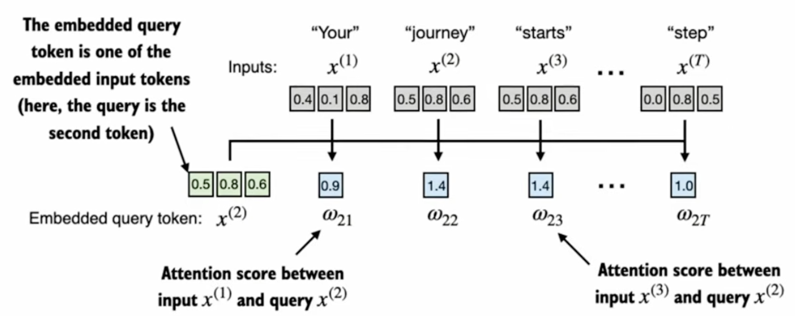

# Notes

## Goal of Simplified Self Attention

Calculate a context vector $Z^{(i)}$ for each element $x^{(i)}$



**Figure 1:** Attention scores $\omega_{2j}$ between the query $x^{(2)}$ ("journey") and each input $x^{(j)}$. *Image credit: Sebastian Raschka, [Build a Large Language Model (From Scratch)](https://www.manning.com/books/build-a-large-language-model-from-scratch), Manning, 2024.*

The First task is to extract the intermediate value `w` which is also called the attention scores (see [Figure 1](#figure-1)).

For a query an a set of input embeddings we have to quantify how much attention we should pay to each of these other embeddings. Here the query is coming from one the the words in the input sequence thus self attention. In [Figure 1](#figure-1) we are queriying for the word "journey".

$w_{2 \leftarrow 1}$ or $w_{21}$ is the attention assigned to word 1 for query 2.

$W_2$ = $x_2$ * $X^T$
where $X^T$ have all the embeddings vectors as columns.

## Normalizing attention scores with softmax

The attention scores are normalized into attention weights $\alpha_{2j}$ that are positive and sum to 1. Softmax is preferred over dividing by the plain sum because it keeps every weight positive and gives more weight to larger scores:

$$\alpha_{2j} = \text{softmax}(w_{2j}) = \frac{e^{w_{2j}}}{\sum_{k=1}^{T} e^{w_{2k}}}$$

PyTorch implementation:

```python
def softmax_naive(x: torch.Tensor) -> torch.Tensor:
    return torch.exp(x) / torch.exp(x).sum(dim=0)

attn_weights_2 = softmax_naive(attn_scores_2)

# Built-in version: subtracts max(x) before exp() so large scores don't overflow
attn_weights_2 = torch.softmax(attn_scores_2, dim=0)
```

`softmax_naive` computes the formula above directly. `torch.softmax` computes a numerically stable version that subtracts the largest score $m$ first:

$$m = \max_{k} w_{2k}$$

$$\alpha_{2j} = \frac{e^{w_{2j} - m}}{\sum_{k=1}^{T} e^{w_{2k} - m}}$$

Both give the same result, because the extra $e^{-m}$ factor cancels between numerator and denominator:

$$\frac{e^{w_{2j} - m}}{\sum_{k} e^{w_{2k} - m}} = \frac{e^{-m}\, e^{w_{2j}}}{e^{-m} \sum_{k} e^{w_{2k}}} = \frac{e^{w_{2j}}}{\sum_{k} e^{w_{2k}}}$$

After subtracting $m$, every exponent is $\le 0$, so each $e^{(\cdot)}$ lies in $(0, 1]$ and can't overflow.
