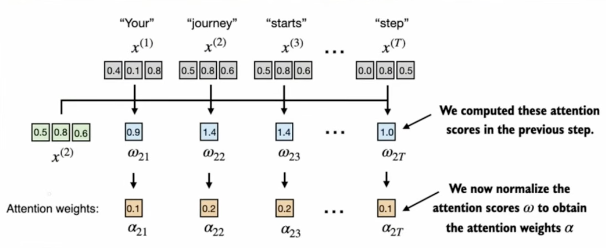
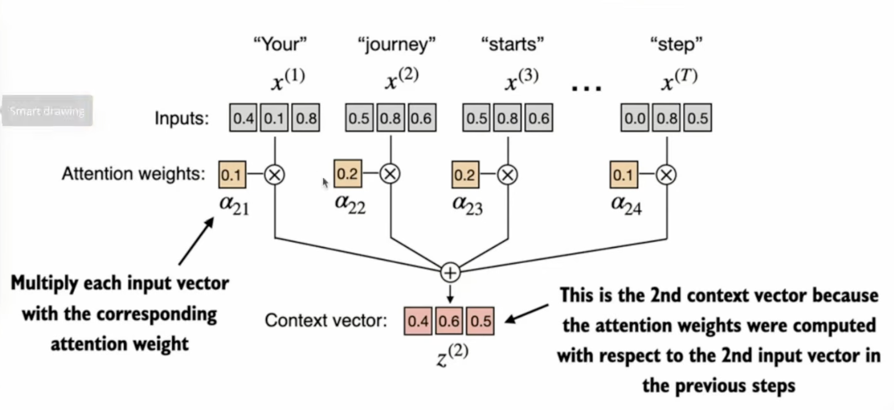
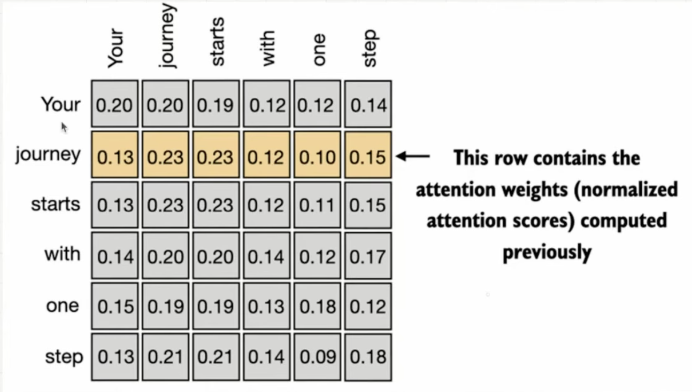

# Notes

## Goal of Simplified Self Attention

Calculate a context vector $Z^{(i)}$ for each element $x^{(i)}$


**Figure 1:** Attention scores $\omega_{2j}$ between the query $x^{(2)}$ ("journey") and each input $x^{(j)}$. *Image credit: Sebastian Raschka, [Build a Large Language Model (From Scratch)](https://www.manning.com/books/build-a-large-language-model-from-scratch), Manning, 2024.*

The First task is to extract the intermediate value `w` which is also called the attention scores (see [Figure 1](#figure-1)).

For a query an a set of input embeddings we have to quantify how much attention we should pay to each of these other embeddings. Here the query is coming from one the the words in the input sequence thus self attention. In [Figure 1](#figure-1) we are queriying for the word "journey".

$w_{2 \leftarrow 1}$ or $w_{21}$ is the attention assigned to word 1 for query 2.

$W_2$ = $x_2$ * $X^T$
where $X^T$ have all the embeddings vectors as columns.

## Normalizing attention scores with softmax



**Figure 2:** The attention scores $\omega_{2j}$ for the query $x^{(2)}$ are normalized into attention weights $\alpha_{2j}$. *Image credit: Sebastian Raschka, [Build a Large Language Model (From Scratch)](https://www.manning.com/books/build-a-large-language-model-from-scratch), Manning, 2024.*

The attention scores are normalized into attention weights $\alpha_{2j}$ that are positive and sum to 1 (see [Figure 2](#figure-2)). Softmax is preferred over dividing by the plain sum because it keeps every weight positive and gives more weight to larger scores:

$$\alpha_{2j} = \text{softmax}(w_{2j}) = \frac{e^{w_{2j}}}{\sum_{k=1}^{T} e^{w_{2k}}}$$

PyTorch implementation:

```python
def softmax_naive(x: torch.Tensor) -> torch.Tensor:
    return torch.exp(x) / torch.exp(x).sum(dim=-1, keepdim=True)

attn_weights_2 = softmax_naive(attn_scores_2)

# Built-in version: subtracts max(x) before exp() so large scores don't overflow
attn_weights_2 = torch.softmax(attn_scores_2, dim=-1)
```

`softmax_naive` computes the formula above directly. `torch.softmax` computes a numerically stable version that subtracts the largest score $m$ first:

$$m = \max_{k} w_{2k}$$

$$\alpha_{2j} = \frac{e^{w_{2j} - m}}{\sum_{k=1}^{T} e^{w_{2k} - m}}$$

Both give the same result, because the extra $e^{-m}$ factor cancels between numerator and denominator:

$$\frac{e^{w_{2j} - m}}{\sum_{k} e^{w_{2k} - m}} = \frac{e^{-m}\, e^{w_{2j}}}{e^{-m} \sum_{k} e^{w_{2k}}} = \frac{e^{w_{2j}}}{\sum_{k} e^{w_{2k}}}$$

After subtracting $m$, every exponent is $\le 0$, so each $e^{(\cdot)}$ lies in $(0, 1]$ and can't overflow.

This matters for large scores: `exp(100)` overflows float32 (max ≈ 3.4e38), so the naive version computes `inf / inf = nan`:

```python
large_scores = torch.tensor([100.0, 101.0, 102.0])
softmax_naive(large_scores)               # tensor([nan, nan, nan])
torch.softmax(large_scores, dim=-1)       # tensor([0.0900, 0.2447, 0.6652])
```

## Computing the context vector



**Figure 3:** Each input vector $x^{(j)}$ is multiplied by its attention weight $\alpha_{2j}$ and the results are summed to get the context vector $z^{(2)}$. *Image credit: Sebastian Raschka, [Build a Large Language Model (From Scratch)](https://www.manning.com/books/build-a-large-language-model-from-scratch), Manning, 2024.*

The context vector is the weighted sum of all the input vectors (see [Figure 3](#figure-3)):

$$z^{(2)} = \sum_{j=1}^{T} \alpha_{2j}\, x^{(j)}$$

PyTorch implementation:

```python
query = inputs[1]  # "journey"
attn_scores_2 = torch.matmul(inputs, query)
attn_weights_2 = torch.softmax(attn_scores_2, dim=-1)

context_vec_2 = torch.zeros(query.shape)
for j, x_j in enumerate(inputs):
    context_vec_2 += attn_weights_2[j] * x_j

# Same weighted sum as a single matrix-vector product
context_vec_2 = torch.matmul(attn_weights_2, inputs)  # tensor([0.4419, 0.6515, 0.5683])
```

## Attention weights for all inputs



**Figure 4:** The attention weight matrix. Row $i$ holds the attention weights $\alpha_{ij}$ for query $x^{(i)}$, and each row sums to 1. The highlighted "journey" row is the one computed above. *Image credit: Sebastian Raschka, [Build a Large Language Model (From Scratch)](https://www.manning.com/books/build-a-large-language-model-from-scratch), Manning, 2024.*

Repeating the same steps for every input as the query gives the full attention weight matrix (see [Figure 4](#figure-4)). With $X$ holding the input embeddings as rows:

$$W = X X^T, \qquad A = \text{softmax}(W) \text{ applied to each row}, \qquad Z = A X$$

Row $i$ of $Z$ is the context vector $z^{(i)}$.

PyTorch implementation:

```python
def simplified_self_attention(x: torch.Tensor) -> torch.Tensor:
    attn_scores = torch.matmul(x, x.T)                 # (T, T)
    attn_weights = torch.softmax(attn_scores, dim=-1)  # normalize each row
    return torch.matmul(attn_weights, x)               # (T, d)

context_vecs = simplified_self_attention(inputs)
```

`dim=-1` normalizes along the last dimension, so each row (one query) sums to 1. Row 2 of `context_vecs` matches `context_vec_2` from above.

## Self-attention with trainable weights

Self-attention adds 3 trainable weight matrices $W_q$, $W_k$, $W_v$ to the simplified attention above. Each input $x^{(i)}$ is projected into a query, a key and a value vector:

$$q^{(i)} = x^{(i)} W_q, \qquad k^{(i)} = x^{(i)} W_k, \qquad v^{(i)} = x^{(i)} W_v$$

The attention scores now come from queries and keys instead of the raw inputs, and the context vector is a weighted sum of the values.

PyTorch implementation for query 2 ("journey"):

```python
d_in = inputs.shape[1]  # input embedding size, 3
d_out = 2               # q/k/v size, kept different from d_in to make the shapes visible

torch.manual_seed(123)
W_query = nn.Parameter(torch.rand(d_in, d_out))
W_key = nn.Parameter(torch.rand(d_in, d_out))
W_value = nn.Parameter(torch.rand(d_in, d_out))

x_2 = inputs[1]
query_2 = torch.matmul(x_2, W_query)    # (d_out,)
keys = torch.matmul(inputs, W_key)      # (T, d_out)
values = torch.matmul(inputs, W_value)  # (T, d_out)
```

## Scaled dot-product attention

The scores are divided by $\sqrt{d_k}$ (the key size) before softmax:

$$\alpha_{2j} = \text{softmax}\left(\frac{q^{(2)} \cdot k^{(j)}}{\sqrt{d_k}}\right), \qquad z^{(2)} = \sum_{j=1}^{T} \alpha_{2j}\, v^{(j)}$$

PyTorch implementation:

```python
attn_scores_2 = torch.matmul(query_2, keys.T)  # (T,)
d_k = keys.shape[-1]
attn_weights_2 = torch.softmax(attn_scores_2 / d_k**0.5, dim=-1)
context_vec_2 = torch.matmul(attn_weights_2, values)  # (d_out,)
```

### Why scale by $\sqrt{d_k}$?

Dividing by $\sqrt{d_k}$ stops the scores from growing with the vector size. Without it, softmax pushes almost all the weight onto one or two tokens, and training stalls.

**Why the scores grow.** A dot product $q \cdot k = \sum_{i=1}^{d_k} q_i k_i$ adds up $d_k$ terms. If each $q_i$ and $k_i$ is roughly zero-mean with variance 1, the sum has variance $d_k$, so a typical score is about $\sqrt{d_k}$ in size. Dividing by $\sqrt{d_k}$ brings the scores back to variance about 1, whatever the head size.

**What large scores do to softmax.** Because of the exponential, large differences between scores send almost all the weight to the largest one. With random $q$ and $k$ for 6 tokens:

| $d_k$ | Version | Score std | Attention weights |
|---|---|---|---|
| 2 | unscaled | 1.27 | `[0.011, 0.105, 0.537, 0.137, 0.139, 0.071]` |
| 2 | scaled | 0.90 | `[0.027, 0.132, 0.419, 0.160, 0.162, 0.101]` |
| 128 | unscaled | 7.41 | `[0.016, 0.000, 0.580, 0.000, 0.000, 0.403]` |
| 128 | scaled | 0.65 | `[0.192, 0.129, 0.263, 0.114, 0.046, 0.255]` |

At $d_k = 2$ scaling barely matters. At $d_k = 128$, a typical head size in real models, the unscaled version gives three tokens zero weight.

**Why that stalls training.** The gradient of softmax for token $j$ is proportional to its weight $\alpha_j$. Tokens with weight ≈ 0 get almost no gradient, so $W_q$ and $W_k$ get no signal to learn whether those tokens should have been attended to.

**Why the simplified version didn't scale.** It had no trainable weights, so there were no gradients to protect, and its vectors were only 3 long, so the scores stayed small. The scaling comes from the original Transformer paper, which is why this is called *scaled* dot-product attention.

## Self-attention for all inputs

With $X$ holding the inputs as rows:

$$Q = X W_q, \quad K = X W_k, \quad V = X W_v, \qquad Z = \text{softmax}\left(\frac{Q K^T}{\sqrt{d_k}}\right) V$$

Wrapping the three matrices in an `nn.Module` registers them as trainable parameters.

PyTorch implementation:

```python
class SelfAttention(nn.Module):
    def __init__(self, d_in: int, d_out: int):
        super().__init__()
        self.W_query = nn.Parameter(torch.rand(d_in, d_out))
        self.W_key = nn.Parameter(torch.rand(d_in, d_out))
        self.W_value = nn.Parameter(torch.rand(d_in, d_out))

    def forward(self, x: torch.Tensor) -> torch.Tensor:
        attn_scores = torch.matmul(torch.matmul(x, self.W_query), torch.matmul(x, self.W_key).T)  # (T, T)
        attn_weights = torch.softmax(attn_scores / self.W_key.shape[-1]**0.5, dim=-1)
        return torch.matmul(attn_weights, torch.matmul(x, self.W_value))                         # (T, d_out)

torch.manual_seed(123)  # same seed as above, so the module gets the same three matrices
context_vecs = SelfAttention(d_in, d_out)(inputs)
```

Row 2 of `context_vecs` matches `context_vec_2` from above.

## Efficient self-attention

Two changes over `SelfAttention`:

1. **One projection instead of three.** $W_q$, $W_k$ and $W_v$ are stored side by side as one $(d_{in}, 3\,d_{out})$ matrix, so a single matmul produces $Q$, $K$ and $V$.
2. **Fused attention.** `F.scaled_dot_product_attention` does the scaling, softmax and weighted sum in one kernel. On NVIDIA GPUs it uses FlashAttention, which is faster and never stores the full $(T, T)$ weight matrix. On a Mac CPU or MPS it runs at about the same speed as the unfused version.

PyTorch implementation:

```python
import torch.nn.functional as F

class SelfAttentionBest(nn.Module):
    def __init__(self, d_in: int, d_out: int):
        super().__init__()
        # W_q, W_k, W_v side by side; created in the same order as SelfAttention so the same seed gives the same values
        self.W_qkv = nn.Parameter(torch.cat([torch.rand(d_in, d_out) for _ in range(3)], dim=-1))

    def forward(self, x: torch.Tensor) -> torch.Tensor:
        queries, keys, values = torch.matmul(x, self.W_qkv).chunk(3, dim=-1)  # each (T, d_out)
        return F.scaled_dot_product_attention(queries, keys, values)          # (T, d_out)

torch.manual_seed(123)
context_vecs_best = SelfAttentionBest(d_in, d_out)(inputs)
```

`context_vecs_best` matches `context_vecs` from `SelfAttention` (within `atol=1e-6`).

## Causal attention

For language modelling, the model predicts each token from the tokens before it, so a token must not see anything that comes after it. Causal (masked) attention sets every score above the diagonal to $-\infty$ before softmax:

$$Z = \text{softmax}\left(\frac{Q K^T}{\sqrt{d_k}} + M\right) V, \qquad M_{ij} = \begin{cases} 0 & j \le i \\ -\infty & j > i \end{cases}$$

Because $e^{-\infty} = 0$, the masked positions get zero weight and each row still sums to 1. Zeroing the weights after softmax instead would leave rows that no longer sum to 1, so they would need normalizing again.

The mask comes from `torch.triu(..., diagonal=1)`, which keeps only the entries strictly above the diagonal. For 4 tokens, `True` marks the future tokens each row must not see:

```
[[False,  True,  True,  True],
 [False, False,  True,  True],
 [False, False, False,  True],
 [False, False, False, False]]
```

PyTorch implementation:

```python
class CausalAttention(nn.Module):
    def __init__(self, d_in: int, d_out: int):
        super().__init__()
        self.W_query = nn.Parameter(torch.rand(d_in, d_out))
        self.W_key = nn.Parameter(torch.rand(d_in, d_out))
        self.W_value = nn.Parameter(torch.rand(d_in, d_out))

    def forward(self, x: torch.Tensor) -> torch.Tensor:
        attn_scores = torch.matmul(torch.matmul(x, self.W_query), torch.matmul(x, self.W_key).T)  # (T, T)
        mask = torch.triu(torch.ones_like(attn_scores, dtype=torch.bool), diagonal=1)             # True for future tokens
        attn_scores = attn_scores.masked_fill(mask, -torch.inf)
        attn_weights = torch.softmax(attn_scores / self.W_key.shape[-1]**0.5, dim=-1)
        return torch.matmul(attn_weights, torch.matmul(x, self.W_value))                         # (T, d_out)

torch.manual_seed(123)  # same seed as SelfAttention, so the same three matrices
causal_context_vecs = CausalAttention(d_in, d_out)(inputs)
```

The first row is just token 1's own value vector, since it can only attend to itself. The last row matches `SelfAttention`, since the last token sees every token. The whole result matches `F.scaled_dot_product_attention(queries, keys, values, is_causal=True)`.

## Causal attention with a stored mask and dropout

Three changes over `CausalAttention`:

1. **Mask built once.** The boolean mask is made in `__init__` for the longest sequence the model accepts (`context_length`), and each call uses its top-left $(T, T)$ corner. `register_buffer` stores it on the module: it moves with `.to(device)` but is not trained. `persistent=False` keeps it out of `state_dict()`, since it can always be rebuilt from `context_length`. Inputs longer than `context_length` fail, because the mask is too small.
2. **Dropout on the attention weights.** During training, `nn.Dropout(p)` sets a random fraction `p` of the weights to 0 and scales the rest by $1/(1-p)$, so the model doesn't depend too much on any one token. `model.eval()` turns it off.
3. **Batched input.** Training feeds the model a batch of $B$ sequences at once. `keys.mT` swaps only the last two dimensions, while `.T` would reverse all three and break the matmul. `torch.matmul` applies the same weight matrices to every sequence, and the $(T, T)$ mask broadcasts over the batch, so each sequence is processed independently.

The shape comments use these names:

| Symbol | Meaning | In the example |
|---|---|---|
| $B$ | Batch size: how many sequences are processed at once | 2 (two copies of the sentence) |
| $T$ | Tokens per sequence (`num_tokens` in the code), at most `context_length` | 6 |
| $d_{in}$ | Size of each input token embedding | 3 |
| $d_{out}$ | Size of each query, key, value and context vector | 2 |

PyTorch implementation:

```python
class CausalAttentionBetter(nn.Module):
    def __init__(self, d_in: int, d_out: int, context_length: int, dropout: float = 0.0):
        super().__init__()
        self.W_query = nn.Parameter(torch.rand(d_in, d_out))
        self.W_key = nn.Parameter(torch.rand(d_in, d_out))
        self.W_value = nn.Parameter(torch.rand(d_in, d_out))
        self.dropout = nn.Dropout(dropout)
        self.register_buffer(
            "mask", torch.triu(torch.ones(context_length, context_length, dtype=torch.bool), diagonal=1), persistent=False
        )

    def forward(self, x: torch.Tensor) -> torch.Tensor:
        num_tokens = x.shape[-2]                 # x is (B, T, d_in), or (T, d_in) without a batch
        queries = torch.matmul(x, self.W_query)  # (B, T, d_out)
        keys = torch.matmul(x, self.W_key)       # (B, T, d_out)
        values = torch.matmul(x, self.W_value)   # (B, T, d_out)

        attn_scores = torch.matmul(queries, keys.mT)                                            # (B, T, T)
        attn_scores = attn_scores.masked_fill(self.mask[:num_tokens, :num_tokens], -torch.inf)  # (T, T) mask broadcasts over B
        attn_weights = torch.softmax(attn_scores / keys.shape[-1]**0.5, dim=-1)
        attn_weights = self.dropout(attn_weights)
        return torch.matmul(attn_weights, values)                                               # (B, T, d_out)

torch.manual_seed(123)
causal_attn_better = CausalAttentionBetter(d_in, d_out, context_length=inputs.shape[0], dropout=0.5)
causal_attn_better.eval()  # dropout off

batch = torch.stack([inputs, inputs])                # (2, 6, 3)
batch_context_vecs = causal_attn_better(batch)       # (2, 6, 2)
```

In `eval()` mode the output matches `CausalAttention`, and each sequence in the batch matches the unbatched result.

## Multi-head attention

A single attention head learns one way of relating tokens to each other. Multi-head attention runs several heads side by side, each with its own $W_q$, $W_k$ and $W_v$, and concatenates their context vectors:

$$Z = \text{concat}(Z_1, Z_2, \dots, Z_h)$$

Each head starts from different random weights, which is what lets the heads learn different patterns. Nothing forces them apart, though, and trained models often have some partly redundant heads.

The simplest version is a wrapper that holds `num_heads` copies of `CausalAttentionBetter`. `nn.ModuleList` registers each head as a submodule, so their weights are trained, moved by `.to(device)` and switched by `.eval()` together.

PyTorch implementation:

```python
class MultiHeadAttentionWrapper(nn.Module):
    def __init__(self, d_in: int, d_out: int, context_length: int, num_heads: int, dropout: float = 0.0):
        super().__init__()
        self.heads = nn.ModuleList(
            [CausalAttentionBetter(d_in, d_out, context_length, dropout) for _ in range(num_heads)]
        )

    def forward(self, x: torch.Tensor) -> torch.Tensor:
        return torch.cat([head(x) for head in self.heads], dim=-1)  # (B, T, num_heads * d_out)

torch.manual_seed(123)
mha_context_vecs = MultiHeadAttentionWrapper(d_in, d_out, context_length=6, num_heads=2)(batch)  # (2, 6, 4)
```

Each head outputs `d_out` values per token, so the output is `(B, T, num_heads * d_out)`: with 2 heads and $d_{out} = 2$, every token gets a 4-dimensional context vector. The first 2 values come from head 1 and the last 2 from head 2. It works for any batch size and any number of heads.

The heads run one after another and each does its own three projections, which is easy to read but slow. A combined `MultiHeadAttention` class does all the heads' projections in one matmul and splits them afterwards.

## Comparison with `nn.MultiheadAttention`

PyTorch ships a ready-made layer, `nn.MultiheadAttention`. It does the Q/K/V projections (stored as one `in_proj_weight`), head splitting, masking, dropout and an output projection `out_proj`. `F.scaled_dot_product_attention` is a lower-level function that does only the $\text{softmax}(QK^T/\sqrt{d_k})V$ step; `nn.MultiheadAttention` uses it internally.

| | `MultiHeadAttentionWrapper` | `nn.MultiheadAttention` |
|---|---|---|
| Output size | `num_heads * d_out` | `embed_dim` (same as the input), split as `num_heads * head_dim` |
| Projections | one matmul per head per Q/K/V | one matmul for all of Q, K, V |
| Causal mask | stored buffer | passed in on each call as `attn_mask` |
| Output projection | none | `out_proj` |
| Biases | none | on by default (`bias=False` to remove) |

**Size requirement.** `d_model` is the usual name for the embedding size of each token (PyTorch calls it `embed_dim`). `nn.MultiheadAttention` requires the output size to equal the input size, and `d_model = num_heads * head_dim`. The sentence `inputs` have $d_{in} = 3$, which can't be split across 2 heads, so the comparison uses a random input with $d_{model} = 4$ = 2 heads × `head_dim` 2:

```
x:            (2, 6, 4)    2 sequences × 6 tokens × d_model 4
head 1 out:   (2, 6, 2)  ┐
head 2 out:   (2, 6, 2)  ┘ concatenated along the last dimension
output:       (2, 6, 4)    = num_heads 2 × head_dim 2
```

Output size = input size is needed because of residual connections: a Transformer block computes `x + attention(x)`, which only works if both have the same shape. The inner size `num_heads * head_dim` can differ from `d_model` in principle (`out_proj` maps it back), but `nn.MultiheadAttention` doesn't allow it.

**Gotchas:**

- Without `batch_first=True` it expects `(T, B, d)`, not `(B, T, d)`.
- It stores no mask, because it is also used for non-causal attention. `nn.Transformer.generate_square_subsequent_mask(T)` builds the causal mask as a 0 / $-\infty$ matrix. `is_causal=True` alone does **not** mask; it only tells PyTorch the mask you pass is causal.
- It stores weights as `(out, in)`, the transpose of ours.
- It returns `(output, attn_weights)`. `need_weights=False` skips the weights and lets it use the fast fused kernel.
- `builtin(x, x, x)` passes the same input as query, key and value, which is self-attention. Different inputs give cross-attention.

PyTorch implementation, copying the wrapper's weights into the built-in layer so the outputs are comparable:

```python
d_model, num_heads = 4, 2
head_dim = d_model // num_heads
torch.manual_seed(123)
x = torch.rand(2, 6, d_model)     # (B, T, d_model)
T = x.shape[1]

ours = MultiHeadAttentionWrapper(d_model, head_dim, context_length=T, num_heads=num_heads)
W_q, W_k, W_v = (torch.cat([getattr(head, name) for head in ours.heads], dim=-1) for name in ("W_query", "W_key", "W_value"))

builtin = nn.MultiheadAttention(d_model, num_heads, bias=False, batch_first=True)
with torch.no_grad():  # in-place changes to trainable parameters need gradient tracking off
    builtin.in_proj_weight.copy_(torch.cat([W_q.T, W_k.T, W_v.T]))  # stacked Q, K, V as (out, in)
    builtin.out_proj.weight.copy_(torch.eye(d_model))               # identity = no-op, since ours has no output projection

mask = nn.Transformer.generate_square_subsequent_mask(T)
builtin_out, _ = builtin(x, x, x, attn_mask=mask, is_causal=True, need_weights=False)  # (2, 6, 4)
```

`builtin_out` matches `ours(x)` (within `atol=1e-6`).
